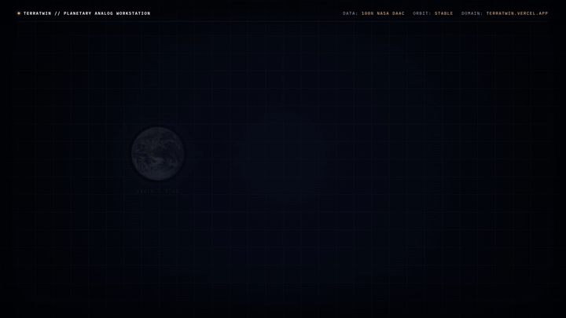

# TerraTwin 🌍🌕🔴

**Earth–Moon–Mars Planetary Analog Discovery & Scientific Intelligence Platform**  
*Built for the NASA Space Apps Challenge: **"Identify Earth Locations that Analog the Permanent Moon Base Locations and Mars"***

> 🚀 **Live Production Application**: [https://terratwin.vercel.app](https://terratwin.vercel.app) (also mirrored at [frontend-nine-livid-46.vercel.app](https://frontend-nine-livid-46.vercel.app))  
> 🛰️ **Live Backend REST API**: [https://backend-one-brown-46.vercel.app/api/health](https://backend-one-brown-46.vercel.app/api/health)  
> 🎬 **Launch & Demo Video**: [brag-output/brag.mp4](brag-output/brag.mp4) (Built with [/brag](https://github.com/latent-spaces/brag))  
> 🗄️ **Database**: MongoDB Atlas Cluster (Connected with 2dsphere indexing & GridFS)

<p align="center">
  
</p>

---

## 🛰️ Executive Summary & PRD Alignment

Space agencies rely on terrestrial environments (analogs) to benchmark rover navigation, test cryogenic drills, simulate EVA spacesuit operations, and study prebiotic chemistry before launching missions into deep space.

**TerraTwin** is an open-source, scientifically grounded discovery workstation that systematically identifies and characterizes Earth locations analogous to candidate **Artemis Lunar South Pole base locations** and **Martian exploration landing zones**.

Altered in strict accordance with the product requirements in `planetary_analog_discovery_prd.docx`:
- **100% NASA Scientific Datasets**: Every parameter, elevation profile, and thermal signature is sourced directly from NASA DAACs and the NASA Planetary Data System (PDS).
- **Explainable Discovery (PRD Section 8)**: Calculates multi-dimensional scientific similarity ($S_{overall} = \frac{\sum w_i S_i}{\sum w_i}$) accompanied by independent metrics for **Data Coverage %** and **Data Confidence %**.
- **Evidence Breakdown**: Explains both why an Earth site is analogous and where the analogy breaks down (atmospheric pressure differences, UV shield, gravity).

---

## ✨ Core Features

### 1. 🌍 Twin Worlds Editorial Experience
- **A cinematic single-page journey** through Earth's closest Mars and Moon analogues: three worlds, the fidelity index, six Mars sites, six Moon sites, three drag-to-compare sliders, the lookalikes and a filterable 16-frame gallery.
- **Ported one-to-one from the Twin Worlds design**: preloader, warp starfield, custom cursor, 3D tilt cards, magnetic buttons, scroll-spy, counters, comparison sliders and reveal animations.
- **Database-backed imagery**: every editorial photo is stored in MongoDB (GridFS bucket `siteassets`) and streamed through `/api/assets/:key`. The browser never contacts an external image host.

### 2. 🎮 Guess the Planet: 10-Level Campaign
- **100 real sites, regrouped as 10 levels of 10 questions** — 48 Earth analogs, 28 lunar features and 24 martian features. Every site is used exactly once.
- **Progressive difficulty**: level 1 draws the easiest frames, level 10 the hardest, and every level mixes Earth, Mars and the Moon.
- **Panchromatic Monochrome (B&W) Display**: photos are black and white until the guess, removing atmospheric colour cues; true colour is revealed only after answering.
- **Authoritative server verification**: the client never receives the answer. The campaign is a sanitized payload and `POST /api/game/guess` scores every guess on the server.
- **NASA telemetry clues**: instrument, mineralogy, terrain and environment. The first clue is free; each extra clue costs 20 points.
- **Scoring & streaks**: base points scale by tier (100 / 150 / 200 / 300); consecutive correct answers add a +20% streak bonus, capped at 2×; a wrong answer scores 0 and resets the streak.
- **Star gating**: each level awards 3★ / 2★ / 1★ or fails. One star unlocks the next level; failed runs can be replayed.
- **Local progression**: cleared levels, stars, best scores and career totals are cached in `localStorage` (`terratwin.game.progress.v2`), so returning players resume at their highest unlocked level.

### 3. 📸 Visual Photo Twin Scanner (`#scanner`)
- **Scan any photo for its planetary twin**: Upload custom landscape photography or choose NASA mission reference presets (*Impact Crater Rim*, *Basaltic Lava Flow*, *Polar Cryo-Permafrost*, *Aeolian Dunes*).
- **Destination targeting**: Toggle between `Mars Twins`, `Moon Twins`, and `Earth Analogues`.
- **Morphological feature extraction**: Computes 6D visual distances across surface roughness, impact crater rims, tholeiitic basalt texture, and polygonal ground ice.
- **Scientific alignment**: Returns the closest matching planetary location with coordinates, similarity %, and morphological rationale.

### 4. 🧭 Parametric Geo-Environmental Analog Finder (`#finder`)
- **Inverse analog modeling**: Input custom geography (terrain roughness, relief delta, slope) and environmental parameters (hyper-aridity, thermal swing $\Delta T$, basalt fraction, operational remoteness).
- **PRD Section 8 hybrid similarity formula**: Computes $S_{overall} = \frac{\sum w_i S_i}{\sum w_i}$ against verified NASA DAAC/PDS datasets (`NASADEM`, `MODIS LST`, `ASTER GED`, `GPM IMERG`, `SEDAC GPWv4`).
- **The Trio of Independent Metrics**: Reports Similarity %, Data Coverage %, and Data Confidence %.
- **Scientific honesty notice**: Documents critical operational deviations (101 kPa Earth atmosphere vs Mars 0.6 kPa / Moon vacuum; 1g vs 0.16g Moon / 0.38g Mars).

### 5. 🗄️ MongoDB-First Media & GridFS Streaming
- Game photography lives in the `gameimages` GridFS bucket and editorial imagery in `siteassets`. Moving from the local Docker database to the production Atlas cluster only requires changing `MONGODB_URI`.

---

## 📡 100% NASA Scientific Datasets Architecture

| Dimension | NASA Dataset | Instrument / Mission | NASA Provider |
| :--- | :--- | :--- | :--- |
| **Topography & Slope** | `NASADEM_HGT v001` (30m) | Space Shuttle Endeavour (SRTM) | NASA LP DAAC |
| **Surface Temperature** | `MOD11A2 v061` (1km) | MODIS on NASA Terra | NASA LP DAAC |
| **Emissivity & Basalt** | `ASTER GED AG100 v003` (100m) | ASTER on NASA Terra | NASA LP DAAC / METI |
| **Hyper-Aridity** | `GPM_3IMERGM v07` (0.1°) | GPM Core Observatory | NASA GES DISC |
| **Operational Remoteness** | `GPWv4.11` (1km) | EOSDIS Gridded Population | NASA SEDAC |
| **Lunar Topography & Slopes** | `LRO LOLA GDR` (20m-237m) | Lunar Orbiter Laser Altimeter | NASA PDS Geosciences |
| **Lunar Cryo Temperatures** | `LRO Diviner Thermal GDR` | Diviner Radiometer on LRO | NASA PDS Geosciences |
| **Martian Topography** | `MGS MOLA MEGDR` (463m) | Mars Orbiter Laser Altimeter | NASA PDS Geosciences |
| **Martian Micro-Roughness** | `MRO HiRISE DTM` (0.25m/px) | High Resolution Imaging Science | NASA PDS / USGS |
| **Martian Mineralogy** | `MRO CRISM Targeted` | CRISM Hyperspectral Imager | NASA PDS Geosciences |

---

## 📁 Repository Structure

```text
TerraTwin/
├── backend/
│   ├── src/
│   │   ├── nasaDataCatalog.js        # 100% NASA datasets, Moon/Mars targets, Earth analogs
│   │   ├── similarityEngine.js       # PRD Section 8 hybrid similarity calculation
│   │   ├── imageSimilarityEngine.js  # Feature 2 visual photo matcher engine
│   │   ├── gameLogic.js              # Public payload, reveal payload and scoring rules
│   │   ├── gameCampaign.js           # 10-level campaign builder (ramp + mixed worlds)
│   │   ├── gameLevelsData.js         # Re-export of the canonical 100-level catalog
│   │   ├── data/
│   │   │   ├── gameCatalog.js        # Canonical 100-level export + validation
│   │   │   ├── siteAssets.js         # Editorial image manifest (Twin Worlds page)
│   │   │   └── levels/               # novice.js · explorer.js · specialist.js · commander.js
│   │   ├── controllers/gameController.js  # Campaign, sanitized levels, scoring, GridFS
│   │   ├── controllers/assetController.js # /api/assets/:key streaming
│   │   ├── models/GameLevel.js       # Mongoose level schema with GridFS image_id
│   │   └── db/seed.js                # GridFS upload + seeding (games + site assets)
│   ├── scripts/fetchGameImages.js    # One-time Wikimedia Commons ingest into .cache/
│   ├── scripts/fetchSiteAssets.js    # Editorial imagery ingest for the landing page
│   ├── docker-compose.yml            # MongoDB 7 with a named volume
│   ├── server.js                     # Node.js / Express REST API
│   ├── package.json                  # Backend dependencies
│   └── backend.md                    # Detailed backend documentation
├── frontend/
│   ├── src/
│   │   ├── twinworlds/               # Twin Worlds page: sections, hooks, content
│   │   │   ├── components/           # Hero, sections, gallery, nav, FX layers
│   │   │   ├── game/                 # Campaign map, run, results, progress
│   │   │   └── content.jsx           # Copy + image keys for every section
│   │   ├── styles/
│   │   │   ├── twinworlds.css        # Verbatim Twin Worlds design system
│   │   │   └── game.css              # Campaign console supplement
│   │   ├── App.jsx                   # Main React application
│   │   └── main.jsx                  # React DOM entrypoint
│   ├── package.json                  # React 18 + Vite 5
│   └── frontend.md                   # Detailed frontend documentation
├── model/
│   └── model.md                      # Reserved (left blank per specifications)
└── README.md                         # Main repository documentation
```

---

## 🛠️ Quickstart

> Prerequisites: Node.js 18+, Docker Desktop (for the local MongoDB 7 instance).

### 1. Start MongoDB and seed the database
```bash
cd backend
npm install
npm run db:up          # starts MongoDB 7 in Docker (named volume: terratwin-mongo-data)
npm run fetch:images    # first run only: downloads the 100 game photos into backend/.cache
npm run fetch:assets    # first run only: downloads the editorial imagery for the landing page
npm run seed            # uploads both image sets to GridFS and seeds the campaigns
```

### 2. Run the Backend (Node.js)
```bash
cd backend
npm run dev
# Running on http://localhost:8000
# Health check: http://localhost:8000/api/health
```

### 3. Run the Frontend (React.js + Vite)
```bash
cd frontend
npm install
npm run dev
# Running on http://localhost:3000
```

The Vite dev server proxies `/api` to `http://localhost:8000`, so no extra
configuration is required. To point at a different backend, set `VITE_API_BASE`.

### Game API
| Method | Endpoint | Purpose |
| :--- | :--- | :--- |
| `GET` | `/api/game/campaign` | 10 levels × 10 sanitized questions, ramped and mixed |
| `GET` | `/api/game/levels` | Sanitized level list (never contains answers) |
| `GET` | `/api/game/levels/:n` | One sanitized level |
| `GET` | `/api/game/image/:n` | Streams the level photo from GridFS (`gameimages`) |
| `POST` | `/api/game/guess` | Authoritative answer check + reveal payload |
| `GET` | `/api/game/stats` | Level and stored-image counts |
| `GET` | `/api/assets/:key` | Streams editorial imagery from GridFS (`siteassets`) |

---

## 📄 Documentation Links
- [Frontend Documentation](./frontend/frontend.md)
- [Backend Documentation](./backend/backend.md)
- [Model Documentation](./model/model.md)

---

## 📜 License
Licensed under the [MIT License](LICENSE). Built for the NASA International Space Apps Challenge.
